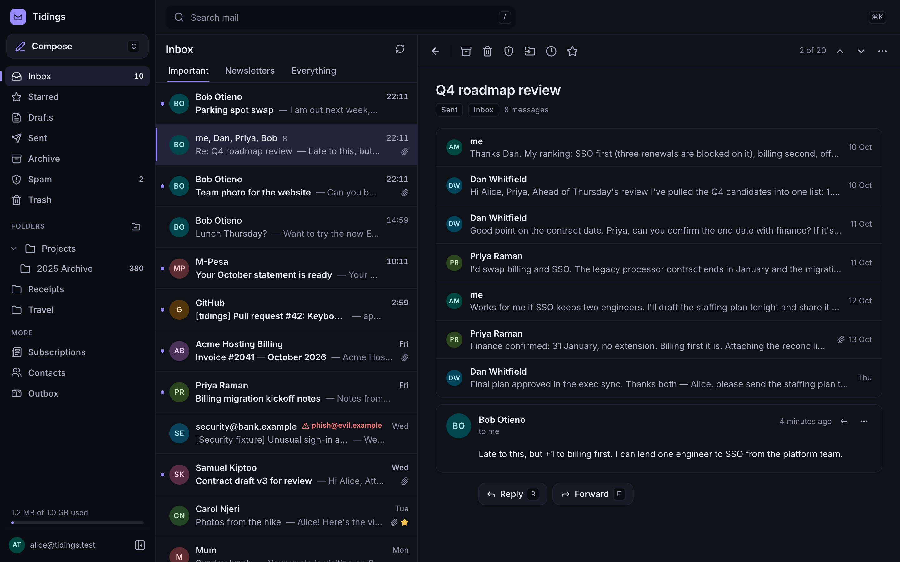
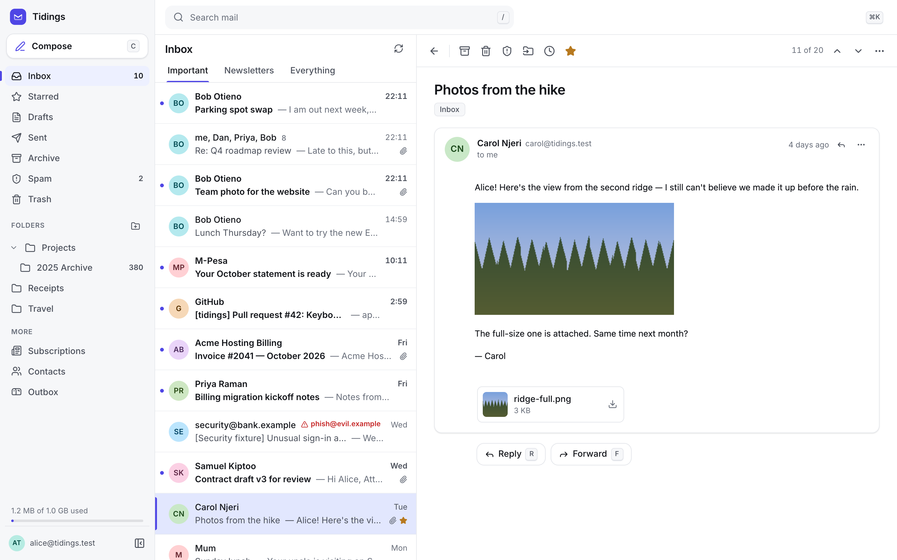
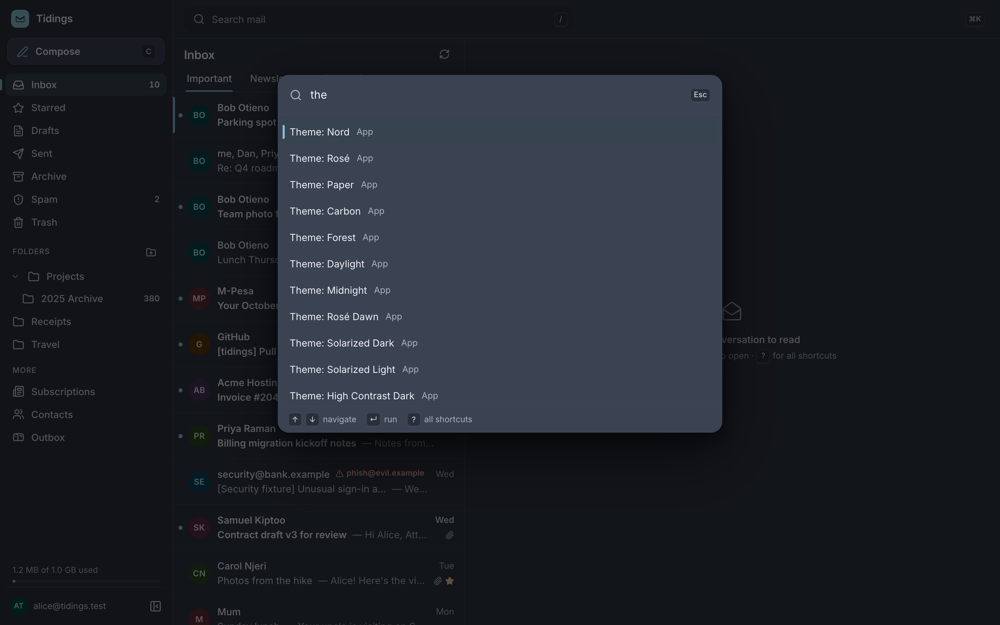
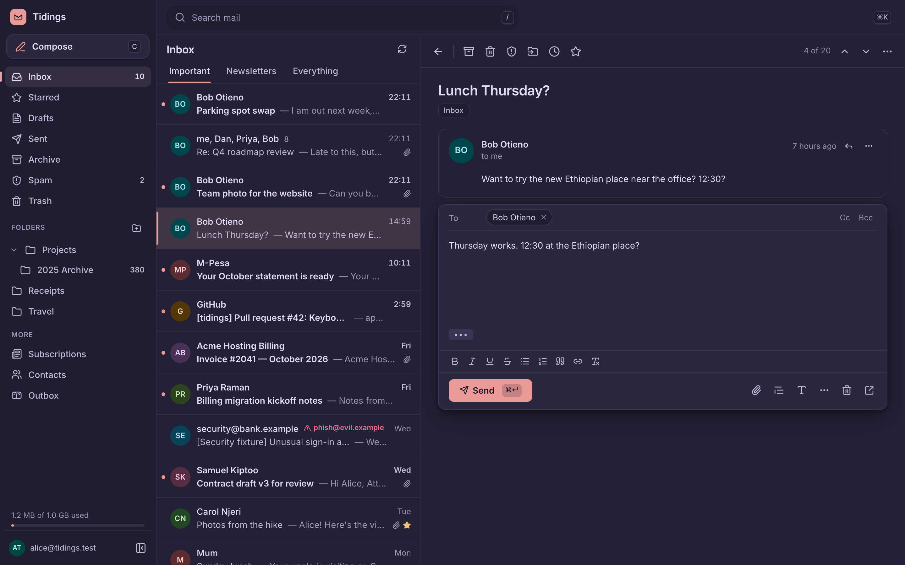
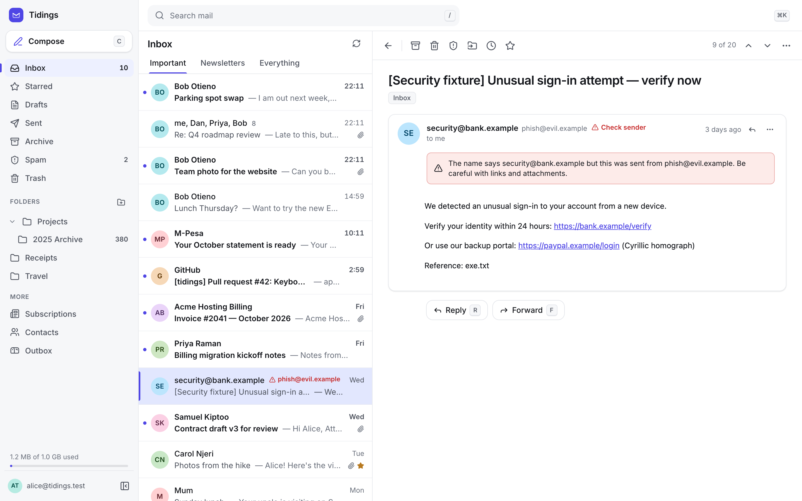
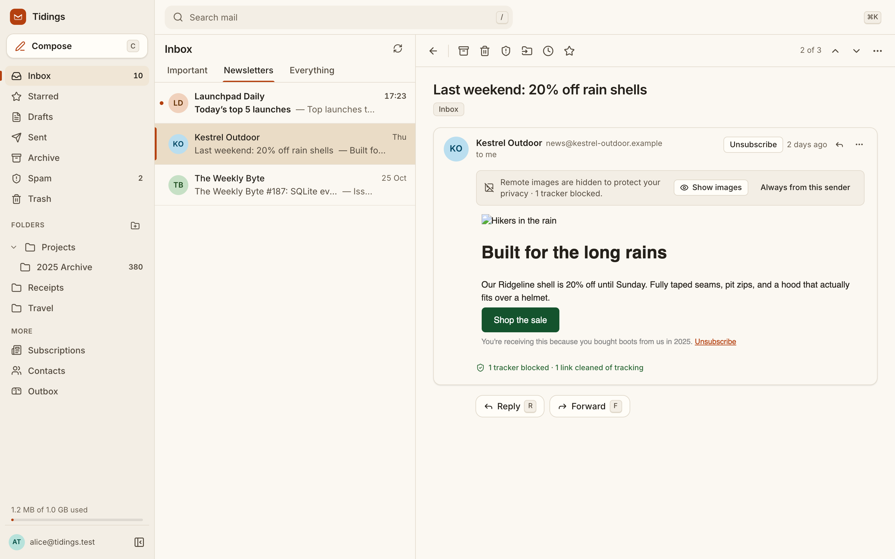
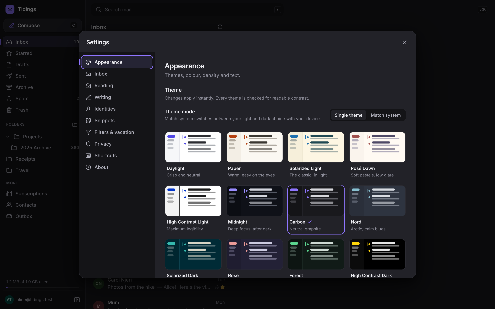
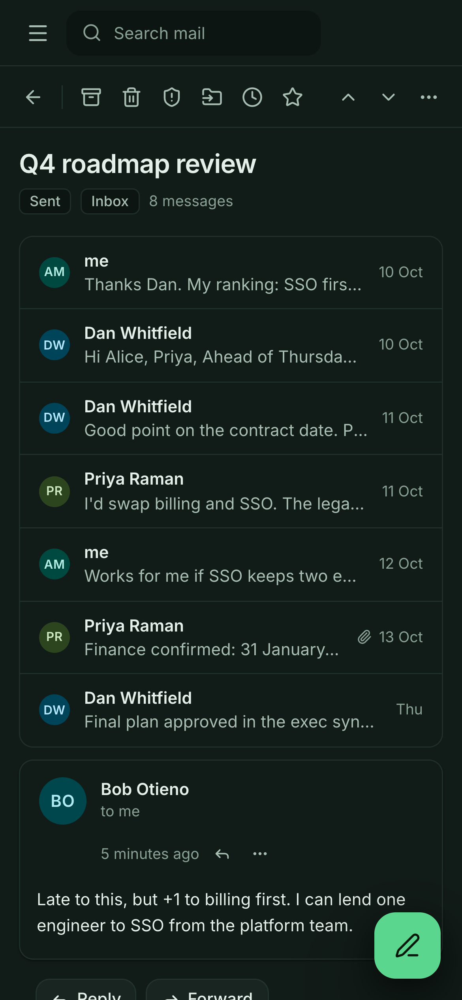

<p align="center">
  
</p>

<h1 align="center">Tidings</h1>

<p align="center">
  <b>Fast, keyboard-first, privacy-respecting webmail for the mail server you already run.</b><br>
  A modern, self-hosted alternative to Roundcube. One container, one volume, any IMAP server.
</p>

<p align="center">
  <a href="https://github.com/apolloshadrack/tidings-webmail/actions/workflows/ci.yml"></a>
  <a href="LICENSE"></a>
</p>

> **Tidings is a webmail client, not a mail server.** It needs an IMAP and SMTP server such as Dovecot +
> Postfix, Stalwart, docker-mailserver, Mailcow or Mailu. Status: **0.1, early**. It works well against
> Dovecot, but expect rough edges elsewhere.

## Why Tidings

Roundcube is dependable, and it still feels like 2010. Tidings borrows the best ideas from the
mail apps people love:

- **From Superhuman:** keyboard everything, a ⌘K command palette that can do any action, split inbox
  tabs, snooze, snippets, a sender sidebar, undo for every action and undo send.
- **From Gmail:** Gmail-compatible shortcuts, conversation view, search operators (`from:`
  `has:attachment` `is:unread` `before:` …), a subscriptions manager with one-click unsubscribe, and a
  "forgot the attachment?" check.
- **From Proton Mail:** private by default. Remote images are blocked and loaded through a proxy that
  hides your IP. Trackers are counted and stripped, link tracking parameters are removed, and
  look-alike links and spoofed sender names are flagged. Twelve accessible themes.

And it keeps what admins choose Roundcube for: filters and vacation replies over ManageSieve, which
keep your existing Roundcube rules working. It also has multi-identity sending with an admin policy,
branding, a sub-path install, fail2ban integration and a `tidings doctor` command.

## A look around

| | |
|---|---|
|  |  |
| Daylight: conversation with attachments | ⌘K does everything, themes included (Nord) |
|  |  |
| Inline reply with undo send (Rosé) | Spoofed senders flagged in the list and the message |
|  |  |
| Split inbox, one-click unsubscribe, trackers blocked (Paper) | Twelve accessible themes (Carbon) |

<p align="center"></p>

## Quick start

```bash
docker run -d --name tidings -p 127.0.0.1:8080:8080 -v tidings-data:/data \
  -e TIDINGS_SECRET="$(openssl rand -base64 48)" \
  -e TIDINGS_PUBLIC_URL=https://mail.example.com/ \
  -e TIDINGS_IMAP_URL=imaps://mail.example.com:993 \
  -e TIDINGS_SMTP_URL=smtp://mail.example.com:587 \
  -e TIDINGS_SIEVE_URL=sieve://mail.example.com:4190 \
  ghcr.io/apolloshadrack/tidings-webmail:latest

docker exec tidings tidings doctor     # checks connectivity, TLS and server capabilities
```

Put it behind your TLS reverse proxy ([nginx, Caddy, Traefik, root or `/webmail`](docs/DEPLOYMENT.md)).
All settings are in [docs/CONFIGURATION.md](docs/CONFIGURATION.md).

## Compared with Roundcube

| | Tidings 0.1 | Roundcube |
|---|---|---|
| Keyboard shortcuts and command palette | ✅ Gmail-compatible, ⌘K for everything | Limited |
| Conversation view across Inbox and Sent | ✅ | Per folder |
| Instant search with operators | ✅ local index; body search on the server | Server search |
| Undo (archive, delete, move, flags) and undo send | ✅ | – |
| Snooze, split inbox, snippets, sender sidebar | ✅ | – |
| Remote content blocked and proxied, tracker removal | ✅ | Blocking only |
| Live updates (IMAP IDLE) | ✅ | Polling |
| Filters and vacation (ManageSieve) | ✅ keeps existing scripts | ✅ |
| Identities and signatures | ✅ admin-controlled policy | ✅ |
| Contacts | ✅ local, vCard import and export | ✅ plus CardDAV and LDAP |
| Themes | 12, WCAG AA checked, custom accent | Skins |
| Translations | English only (help wanted) | 80+ languages |
| OAuth / SSO sign-in, 2FA | Not yet | Plugins |
| Plugins | Not yet | Large ecosystem |
| Password change | Not yet | Plugin |
| Stack | Node, single process, SQLite | PHP and SQL database |

## Keyboard

| Keys | Action | Keys | Action |
|---|---|---|---|
| `j` `k` | Next / previous | `e` | Archive |
| `↵` `o` | Open | `#` | Delete |
| `u` / `Esc` | Back to list | `!` | Spam / not spam |
| `x` | Select | `v` | Move to… |
| `c` | Compose | `h` | Snooze |
| `r` `a` `f` | Reply / all / forward | `s` | Star |
| `/` | Search | `⇧I` `⇧U` | Read / unread |
| `⌘K` | Command palette | `z` | Undo |
| `g i` `g t` `g d` | Inbox / Sent / Drafts | `?` | All shortcuts |

## Security

Untrusted mail never runs code in the Tidings origin. HTML is sanitised with DOMPurify and shown in a
script-less sandboxed iframe with its own CSP. Attachments are served as downloads unless their bytes
prove they're a raster image. Credentials are encrypted with a key that needs both the server secret and
the user's cookie. The full threat model is in [SECURITY.md](SECURITY.md) and
[docs/SPEC.md](docs/SPEC.md#appendix-a--binding-security-decisions-c-from-the-security-review). Please
report vulnerabilities privately.

## Development

```bash
npm install
npm run mail:reset   # local Dovecot + SMTP sink on loopback, seeded with realistic mail
npm run dev          # http://localhost:5304 — alice@tidings.test / tidings-dev
```

See [CONTRIBUTING.md](CONTRIBUTING.md) and [docs/ARCHITECTURE.md](docs/ARCHITECTURE.md).
Tidings was shaped by two rounds of adversarial review. Before any code, a power user, an email
security engineer and a hosting admin attacked the spec. An art director, a power user and an
accessibility and security auditor then tested the running app. Their findings and the fixes are
recorded in [docs/SPEC.md](docs/SPEC.md#appendix-b--round-2-review-of-the-running-app).

## Licence

[AGPL-3.0-or-later](LICENSE), with an [additional permission](LICENSE-EXCEPTION.md) so that logos,
custom CSS and configuration stay yours. If you modify Tidings and offer it to users over a network,
publish your changes and set `TIDINGS_SOURCE_URL` to them.
